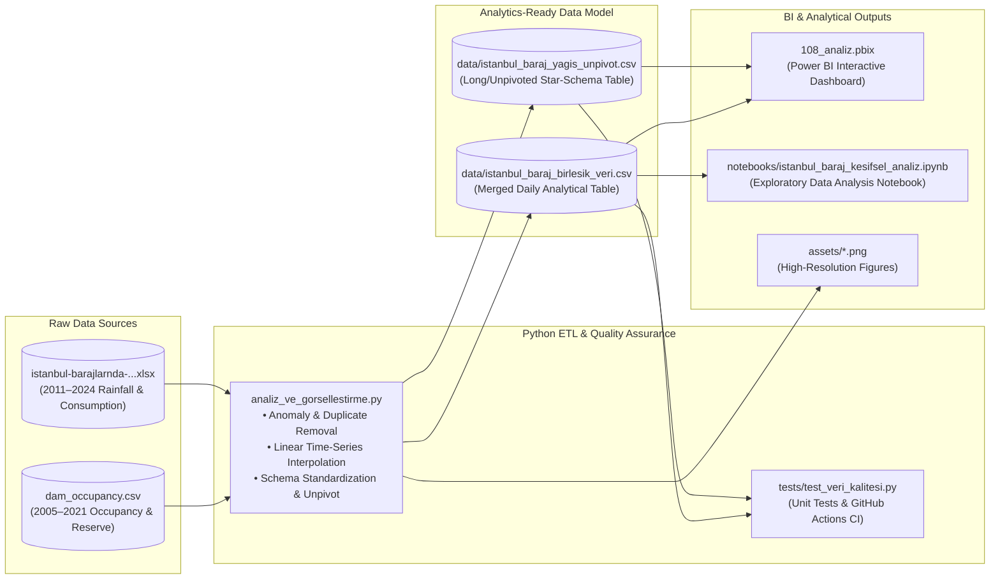

# 💧 Istanbul Dam Occupancy, Basin Precipitation & Daily Water Consumption Analytics

> 🌐 **Language / Dil:** **🇬🇧 English** | [🇹🇷 Türkçe](README.tr.md)

[](https://github.com/Uguravsar75/istanbul-baraj-analizi/actions/workflows/veri_kalite_kontrol.yml)


An end-to-end **Data Analytics & Business Intelligence (BI)** project analyzing daily precipitation across **Istanbul's 10 major dam basins** (*Ömerli, Darlık, Elmalı, Terkos, Büyükçekmece, Sazlıdere, Alibey, Kazandere, Pabuçdere, Istrancalar*), overall reservoir occupancy rates (`2005–2021`), reserved water volumes, and daily urban water consumption trends (`2011–2024`) using **Power BI** and **Python**.


---

## 📑 Table of Contents
1. [Project Objectives](#-project-objectives)
2. [Data Architecture & ETL Pipeline](#-data-architecture--etl-pipeline)
3. [Datasets & Data Quality Engineering](#-datasets--data-quality-engineering)
4. [Key Analytical Findings](#-key-analytical-findings)
5. [Spatial Basin Correlation & Drought Risk Analysis](#-spatial-basin-correlation--drought-risk-analysis)
6. [Power BI Report & Custom Theme](#-power-bi-report-108_analizpbix)
7. [Installation, Testing & Usage](#-installation-testing--usage)
8. [Repository Structure](#-repository-structure)

---

## 🎯 Project Objectives

- **Climate & Drought Monitoring:** Track daily dam occupancy rates (`2005–2021`) and basin-level precipitation (`2011–2024`) to identify critical drought periods (`<30%` occupancy threshold).
- **Urban Water Demand Analysis:** Quantify long-term and seasonal growth in Istanbul's daily water consumption driven by population growth and climatic variations.
- **Seasonal Cycle & Spatial Clustering:** Model the inverse seasonal relationship between spring reservoir peaks and summer consumption peaks, and uncover spatial rainfall regimes across the 10 dam basins via correlation analysis.
- **Interactive BI Reporting:** Deliver an interactive **Power BI** dashboard (`108_analiz.pbix`) supporting dynamic date-range filtering, date hierarchy drill-downs, and cross-basin comparisons.

---

## 🏗️ Data Architecture & ETL Pipeline



---

## 📂 Datasets & Data Quality Engineering

Two primary datasets were audited, cleaned, and transformed into Star-Schema-compatible analytical tables:

| File Path | Coverage Period | Row Count | Description |
| :--- | :--- | :---: | :--- |
| [`dam_occupancy.csv`](dam_occupancy.csv) | `2005-01-01` – `2021-04-07` | 5,941 days | Daily general dam occupancy rate (`%`) and reserved water volume (`Million m³`). |
| [`istanbul-barajlarnda-ya-ve-gunluk-tuketim-verileri.xlsx`](istanbul-barajlarnda-ya-ve-gunluk-tuketim-verileri.xlsx) | `2011-01-01` – `2024-02-18` | 4,797 days | Daily precipitation (`mm`) across 10 dam basins and city-wide daily water consumption (`m³/day`). |
| [`data/istanbul_baraj_birlesik_veri.csv`](data/istanbul_baraj_birlesik_veri.csv) | `2011-01-01` – `2024-02-18` | 4,797 days | Merged daily dataset with standardized basin names, total/mean rainfall, season tags, and occupancy metrics. |
| [`data/istanbul_baraj_yagis_unpivot.csv`](data/istanbul_baraj_yagis_unpivot.csv) | `2011-01-01` – `2024-02-18` | 47,970 rows | **Unpivoted (Long-Format)** basin precipitation dataset designed for Power BI X-axis categorization and slicers. |

### 🛠️ Data Cleaning & Preprocessing Steps
1. **Anomaly & Duplicate Resolution (`dam_occupancy.csv`):**
   - Removed an erroneous outlier duplicate on `2020-04-19` (`80.79% / 701 Million m³` inserted between `70.08%` on April 18 and `70.01%` on April 20) while retaining the valid record (`70.03% / 608 Million m³`).
   - Removed an exact duplicate record on `2021-01-07` (`19.35% / 168 Million m³`), ensuring `DATE` serves as a **100% unique Primary Key** for `1:N` (One-to-Many) relationships in Power BI.
2. **Missing Date Imputation (`dam_occupancy.csv`):**
   - Identified and imputed two missing calendar dates—`2020-06-05` (`66.50% / 578 Million m³`) and `2020-07-31` (`57.24% / 497 Million m³`)—via linear interpolation to establish an unbroken 5,941-day daily time series.
3. **Schema & Structural Standardization (`Excel`):**
   - Dropped the empty separator column `Unnamed: 11` (`4,797 NaN` rows), reducing file size by ~27%.
   - Standardized inconsistent Turkish characters and casing across basin names (`ıstırancalar` $\rightarrow$ `Istrancalar`, `Darlik` $\rightarrow$ `Darlık`, `Elmali` $\rightarrow$ `Elmalı`, `Sazlidere` $\rightarrow$ `Sazlıdere`, `B.çekmece` $\rightarrow$ `Büyükçekmece`).

---

## 📊 Key Analytical Findings

### 1. Reservoir Occupancy Dynamics (2005–2021)
- **Mean Occupancy Rate:** `64.76%` (Mean Reserved Water Volume: `562.5 Million m³`)
- **Peak Occupancy:** `99.16%` (`861 Million m³` — April 2006 & April 2010)
- **Historical Low (Severe Drought):** `9.20%` (`80 Million m³` — November 2007). Secondary severe drought troughs occurred in **2014** (`14.62%`) and **January 2021** (`19.16%`).

### 2. Urban Daily Water Consumption Trends (2011–2024)
- **Mean Daily Consumption:** `2,737,182 m³/day`
- **Minimum Daily Consumption:** `1,949,139 m³/day` (`March 31, 2015` — nationwide power blackout)
- **Maximum Daily Consumption:** `3,568,056 m³/day` (`Summer 2023 peak`)
- **Long-Term Growth:** Average daily water demand rose by **35.4%**, climbing from `2.26 Million m³/day` in 2011 to `3.06 Million m³/day` in 2023.

### 3. Cumulative Basin Precipitation Ranking (2011–2024)
Northern Black Sea coastal basins (*Kazandere, Pabuçdere, Istrancalar, Terkos*) receive the highest precipitation, whereas southwestern inland/coastal basins (*Büyükçekmece, Sazlıdere*) receive significantly less rainfall:

| Rank | Dam Basin | Cumulative Rainfall (2011–2024) | Annual Average Rainfall | Max Daily Rainfall | Rainy Days Ratio (`>0.1 mm`) |
| :---: | :--- | :---: | :---: | :---: | :---: |
| 1 | **Kazandere** | `12,469.71 mm` | `949.5 mm/yr` | `170.20 mm` | `28.5%` |
| 2 | **Pabuçdere** | `11,746.52 mm` | `894.4 mm/yr` | `171.08 mm` | `28.1%` |
| 3 | **Istrancalar** | `11,646.06 mm` | `886.7 mm/yr` | `172.00 mm` | `31.6%` |
| 4 | **Terkos** | `11,563.70 mm` | `880.5 mm/yr` | `131.28 mm` | `33.7%` |
| 5 | **Darlık** | `10,883.03 mm` | `828.6 mm/yr` | `82.69 mm` | `31.6%` |
| 6 | **Ömerli** | `9,952.14 mm` | `757.8 mm/yr` | `123.53 mm` | `31.5%` |
| 7 | **Alibey** | `9,682.35 mm` | `737.2 mm/yr` | `119.00 mm` | `31.2%` |
| 8 | **Elmalı** | `9,045.56 mm` | `688.7 mm/yr` | `95.47 mm` | `31.1%` |
| 9 | **Sazlıdere** | `8,734.18 mm` | `665.0 mm/yr` | `178.25 mm` | `29.8%` |
| 10 | **Büyükçekmece** | `8,057.23 mm` | `613.5 mm/yr` | `95.59 mm` | `28.8%` |


---

## 🌍 Spatial Basin Correlation & Drought Risk Analysis

Pairwise Pearson correlation analysis of daily precipitation across the 10 dam basins reveals **3 distinct geographic micro-climate clusters**:
1. **Northwestern Thrace / Black Sea Belt (`Kazandere`, `Pabuçdere`, `Istrancalar`):** Exhibits strong intra-cluster correlation ($r = 0.84 - 0.95$) but lower correlation with Asian-side basins ($r = 0.36 - 0.45$).
2. **Anatolian (Asian) Side Basins (`Ömerli`, `Darlık`, `Elmalı`):** Demonstrates high synchronous rainfall correlation ($r = 0.76 - 0.82$).
3. **European Side Inner Basins (`Büyükçekmece`, `Sazlıdere`, `Alibey`):** Forms a cohesive hydrological cluster ($r = 0.74 - 0.80$).


---

## 📈 Power BI Report (`108_analiz.pbix`)

The interactive Power BI report (`İstanbul Baraj ve Su Tüketim Analizi`) is structured on a pixel-aligned `1280x720` (16:9) canvas with 5 core visual components:

1. **Average Dam Occupancy Rate (%) Card:** Displays the mean reservoir occupancy percentage for the selected period (`Average`).
2. **Total Water Consumption (m³) Card:** Displays cumulative urban water consumption (`Sum`).
3. **Interactive Date Range Slicer:** Configured in `Between` (range slider) mode for seamless temporal filtering.
4. **Annual Basin Precipitation Trend (mm) Line Chart:** Tracks rainfall trends across all 10 dam basins with full `Year -> Quarter -> Month -> Day` hierarchy drill-down.
5. **Cumulative Basin Precipitation Comparison (mm) Column Chart:** Compares total precipitation volumes across all 10 dam basins side by side.

> 📌 **Advanced DAX, Power Query (M) & Corporate Theme:**
> - For ready-to-use DAX measures (`30-Day Moving Average`, `YoY Consumption Growth %`, `Drought Risk Tier`), a dynamic `Dim_Tarih` calendar table, and Power Query Unpivot scripts, see 👉 **[`powerbi/dax_ve_powerquery_rehberi.md`](powerbi/dax_ve_powerquery_rehberi.md)**.
> - To apply the custom water-management color palette in Power BI Desktop (`View -> Themes -> Browse for themes`), import 👉 **[`powerbi/istanbul_su_temasi.json`](powerbi/istanbul_su_temasi.json)**.

---

## 🚀 Installation, Testing & Usage

### 1. Clone the Repository & Run the ETL / Visualization Pipeline

```bash
git clone https://github.com/Uguravsar75/istanbul-baraj-analizi.git
cd istanbul-baraj-analizi
pip install -r requirements.txt
python3 analiz_ve_gorsellestirme.py
```

### 2. Run Automated Data Quality Unit Tests

```bash
python3 -m unittest discover -s tests -p "test_*.py" -v
```

### 3. Explore the Interactive Jupyter Notebook
View the pre-executed Exploratory Data Analysis notebook with inline tables and plots directly on GitHub at **[`notebooks/istanbul_baraj_kesifsel_analiz.ipynb`](notebooks/istanbul_baraj_kesifsel_analiz.ipynb)**, or launch it locally via `jupyter lab`.

---

## 📁 Repository Structure

```text
istanbul-baraj-analizi/
├── .github/workflows/
│   └── veri_kalite_kontrol.yml                               # GitHub Actions automated data quality & ETL CI pipeline
├── assets/
│   ├── dashboard_ozet.png                                    # 4-panel executive summary dashboard figure
│   ├── mevsimsel_isi_haritasi.png                            # Year x Month precipitation heatmap (2011–2023)
│   └── korelasyon_ve_kuraklik_analizi.png                    # Basin correlation matrix & critical drought (<30%) analysis
├── data/
│   ├── istanbul_baraj_birlesik_veri.csv                      # Cleaned & merged daily analytical dataset
│   └── istanbul_baraj_yagis_unpivot.csv                      # Long-format (Unpivoted) basin precipitation dataset
├── notebooks/
│   └── istanbul_baraj_kesifsel_analiz.ipynb                  # Pre-executed Exploratory Data Analysis (EDA) Jupyter Notebook
├── powerbi/
│   ├── dax_ve_powerquery_rehberi.md                          # Advanced DAX measures, Calendar table & Power Query (M) guide
│   └── istanbul_su_temasi.json                               # Custom Power BI corporate color theme (JSON)
├── tests/
│   └── test_veri_kalitesi.py                                 # Data integrity, primary-key uniqueness & schema unit tests
├── 108_analiz.pbix                                           # Optimized Power BI Report file
├── analiz_ve_gorsellestirme.py                               # End-to-end Python ETL, validation & visualization script
├── dam_occupancy.csv                                         # Cleaned daily dam occupancy dataset (2005–2021)
├── istanbul-barajlarnda-ya-ve-gunluk-tuketim-verileri.xlsx   # Cleaned basin precipitation & water consumption dataset (2011–2024)
├── requirements.txt                                          # Python dependencies
├── LICENSE                                                   # MIT Open-Source License
├── .gitignore                                                # Git ignore rules
├── README.md                                                 # Primary English documentation
└── README.tr.md                                              # Turkish documentation
```
