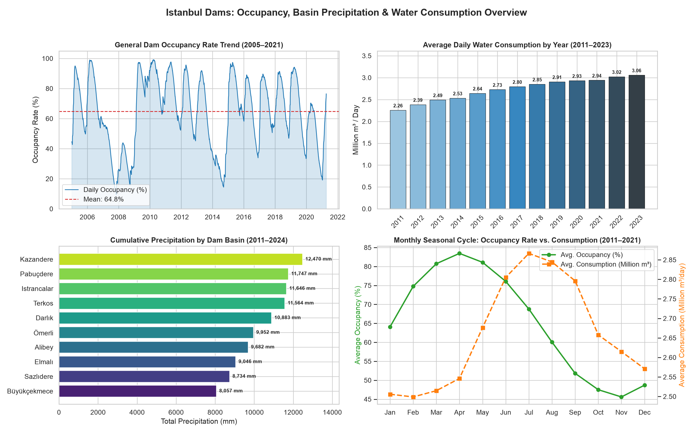
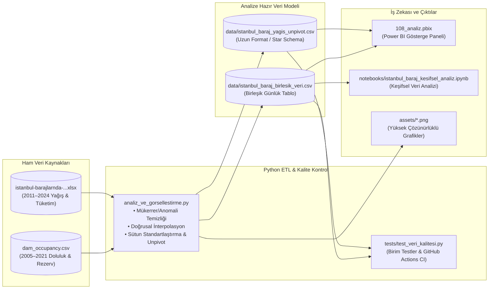
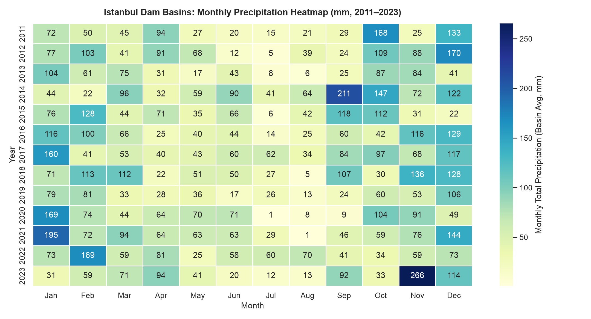
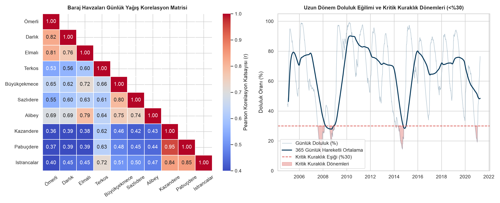

# 💧 İstanbul Barajları Doluluk, Yağış ve Günlük Su Tüketimi Analizi

[](https://github.com/Uguravsar75/istanbul-baraj-analizi/actions/workflows/veri_kalite_kontrol.yml)


Bu proje, İstanbul'daki **10 ana baraj havzasının** (Ömerli, Darlık, Elmalı, Terkos, Büyükçekmece, Sazlıdere, Alibey, Kazandere, Pabuçdere, Istrancalar) günlük yağış verilerini, İstanbul genel baraj doluluk oranlarını, rezerv su miktarlarını ve günlük su tüketim eğilimlerini **Power BI** ve **Python** kullanarak inceleyen uçtan uca bir veri analitiği ve iş zekası (BI) çalışmasıdır.



---

## 📑 İçindekiler
1. [Projenin Amacı](#-projenin-amacı)
2. [Veri Mimarisi ve ETL Akışı](#-veri-mimarisi-ve-etl-akışı)
3. [Veri Setleri ve Veri Kalitesi İyileştirmeleri](#-veri-setleri-ve-veri-kalitesi-iyileştirmeleri-etl)
4. [Temel Analitik Bulgular](#-temel-analitik-bulgular)
5. [Coğrafi Havza Korelasyonu ve Kuraklık Risk Analizi](#-coğrafi-havza-korelasyonu-ve-kuraklık-risk-analizi)
6. [Power BI Raporu ve Kurumsal Tema](#-power-bi-raporu-108_analizpbix)
7. [Kurulum, Testler ve Çalıştırma](#-kurulum-testler-ve-çalıştırma)
8. [Proje Dizin Yapısı](#-proje-dizin-yapısı)

---

## 🎯 Projenin Amacı

- **İklim ve Kuraklık Takibi:** 2005–2021 yılları arasındaki günlük baraj doluluk oranlarını ve 2011–2024 yılları arasındaki baraj havzası yağışlarını inceleyerek kritik kurak dönemleri (`<%30`) tespit etmek.
- **Tüketim Trendi Analizi:** İstanbul'un nüfus ve kullanım artışına paralel olarak günlük su tüketiminin yıllar ve mevsimler bazında nasıl değiştiğini ortaya koymak.
- **Mevsimsel Döngü ve Havza Kümelemesi:** Barajların en yüksek doluluğa ulaştığı ilkbahar ayları ile su tüketiminin zirve yaptığı yaz ayları arasındaki ters yönlü mevsimsel ilişkiyi ve 10 baraj havzasının coğrafi yağış korelasyonunu modellemek.
- **İş Zekası (BI) Raporlaması:** Power BI (`108_analiz.pbix`) üzerinde interaktif filtreleme, zaman hiyerarşisi ve baraj bazlı karşılaştırma imkânı sunan bir gösterge paneli oluşturmak.

---

## 🏗️ Veri Mimarisi ve ETL Akışı



---

## 📂 Veri Setleri ve Veri Kalitesi İyileştirmeleri (ETL)

Projede iki temel veri kaynağı kullanılmış, ham verilerdeki kalite sorunları giderilerek analize hazır türetilmiş tablolar üretilmiştir:

| Dosya Adı | Kapsam / Dönem | Satır Sayısı | Açıklama |
| :--- | :--- | :---: | :--- |
| [`dam_occupancy.csv`](dam_occupancy.csv) | `2005-01-01` – `2021-04-07` | 5.941 gün | Günlük genel baraj doluluk oranı (`%`) ve rezerv su hacmi (`Milyon m³`). |
| [`istanbul-barajlarnda-ya-ve-gunluk-tuketim-verileri.xlsx`](istanbul-barajlarnda-ya-ve-gunluk-tuketim-verileri.xlsx) | `2011-01-01` – `2024-02-18` | 4.797 gün | 10 baraj havzasının günlük yağış miktarları (`mm`) ve İstanbul günlük su tüketimi (`m³/gün`). |
| [`data/istanbul_baraj_birlesik_veri.csv`](data/istanbul_baraj_birlesik_veri.csv) | `2011-01-01` – `2024-02-18` | 4.797 gün | Standartlaştırılmış sütun adları, toplam/ortalama yağış, mevsim ve doluluk verilerini içeren birleştirilmiş tablo. |
| [`data/istanbul_baraj_yagis_unpivot.csv`](data/istanbul_baraj_yagis_unpivot.csv) | `2011-01-01` – `2024-02-18` | 47.970 satır | Power BI'da baraj bazlı dilimleme ve X-ekseni kullanımı için **Unpivot (Uzun Format)** haline getirilmiş yağış tablosu. |

### 🛠️ Yapılan Veri Temizleme (Data Cleaning) İşlemleri
1. **Mükerrer ve Hatalı Kayıtların Giderilmesi (`dam_occupancy.csv`):**
   - `2020-04-19` tarihinde yer alan hatalı/anomali kayıt (`%80.79 / 701 Milyon m³` — önceki ve sonraki gün `%70.08` ve `%70.01` iken) temizlendi, doğru kayıt (`%70.03 / 608 Milyon m³`) korundu.
   - `2021-01-07` tarihindeki birebir mükerrer satır kaldırılarak `DATE` sütununun Power BI `1:N` (One-to-Many) ilişkisi için **%100 tekil birincil anahtar (Primary Key)** olması sağlandı.
2. **Eksik Günlerin Tamamlanması (`dam_occupancy.csv`):**
   - Zaman serisinde eksik olan `2020-06-05` (`%66.50 / 578 Milyon m³`) ve `2020-07-31` (`%57.24 / 497 Milyon m³`) tarihleri komşu günlerle doğrusal interpolasyon (linear interpolation) uygulanarak tamamlandı.
3. **Yapısal Temizlik ve Standartlaştırma (`Excel`):**
   - Excel dosyasındaki tamamen boş `Unnamed: 11` (L sütunu) kaldırıldı.
   - Türkçe karakter ve büyük/küçük harf tutarsızlıkları (`ıstırancalar` $\rightarrow$ `Istrancalar`, `Darlik` $\rightarrow$ `Darlık`, `Elmali` $\rightarrow$ `Elmalı`, `Sazlidere` $\rightarrow$ `Sazlıdere`, `B.çekmece` $\rightarrow$ `Büyükçekmece`) standartlaştırıldı.

---

## 📊 Temel Analitik Bulgular

### 1. Baraj Doluluk Oranları (2005–2021)
- **Ortalama Doluluk Oranı:** `%64.76` (Ortalama Rezerv Su: `562.5 Milyon m³`)
- **En Yüksek Doluluk:** `%99.16` (`861 Milyon m³` — Nisan 2006 & Nisan 2010)
- **En Düşük Doluluk (Kritik Kuraklık):** `%9.20` (`80 Milyon m³` — Kasım 2007). Ayrıca **2014** (`%14.62`) ve **Ocak 2021** (`%19.16`) dönemleri yakın tarihin en sert kuraklık süreçleri olarak öne çıkmaktadır.

### 2. Günlük Su Tüketimi Eğilimi (2011–2024)
- **Ortalama Günlük Tüketim:** `2.737.182 m³/gün`
- **Minimum Tüketim:** `1.949.139 m³/gün` (`31 Mart 2015` — Türkiye genel elektrik kesintisi günü)
- **Maksimum Tüketim:** `3.568.056 m³/gün` (`2023 yaz dönemi`)
- **Yıllık Artış:** 2011 yılında ortalama `2.26 Milyon m³/gün` olan su tüketimi, 2023 yılına gelindiğinde **%35.4 artışla** ortalama `3.06 Milyon m³/gün` seviyesine ulaşmıştır.

### 3. Baraj Havzalarına Göre Yağış Dağılımı (2011–2024)
Kuzey ve Karadeniz kıyı kuşağındaki havzalar (Kazandere, Pabuçdere, Istrancalar, Terkos) en yüksek yağışı alırken, güneybatıdaki sığ havzalar (Büyükçekmece, Sazlıdere) en düşük yağışı almaktadır:

| Sıra | Baraj Havzası | Kümülatif Yağış (2011–2024) | Yıllık Ortalama Yağış | Günlük Maksimum Yağış | Yağışlı Gün Oranı (`>0.1 mm`) |
| :---: | :--- | :---: | :---: | :---: | :---: |
| 1 | **Kazandere** | `12.469,71 mm` | `949,5 mm/yıl` | `170,20 mm` | `%28,5` |
| 2 | **Pabuçdere** | `11.746,52 mm` | `894,4 mm/yıl` | `171,08 mm` | `%28,1` |
| 3 | **Istrancalar** | `11.646,06 mm` | `886,7 mm/yıl` | `172,00 mm` | `%31,6` |
| 4 | **Terkos** | `11.563,70 mm` | `880,5 mm/yıl` | `131,28 mm` | `%33,7` |
| 5 | **Darlık** | `10.883,03 mm` | `828,6 mm/yıl` | `82,69 mm` | `%31,6` |
| 6 | **Ömerli** | `9.952,14 mm` | `757,8 mm/yıl` | `123,53 mm` | `%31,5` |
| 7 | **Alibey** | `9.682,35 mm` | `737,2 mm/yıl` | `119,00 mm` | `%31,2` |
| 8 | **Elmalı** | `9.045,56 mm` | `688,7 mm/yıl` | `95,47 mm` | `%31,1` |
| 9 | **Sazlıdere** | `8.734,18 mm` | `665,0 mm/yıl` | `178,25 mm` | `%29,8` |
| 10 | **Büyükçekmece** | `8.057,23 mm` | `613,5 mm/yıl` | `95,59 mm` | `%28,8` |



---

## 🌍 Coğrafi Havza Korelasyonu ve Kuraklık Risk Analizi

Baraj havzalarının günlük yağış korelasyon matrisi incelendiğinde İstanbul'da **3 belirgin mikro-iklim/havza kümesi** ortaya çıkmaktadır:
1. **Trakya / Kuzeybatı Karadeniz Kuşağı (`Kazandere`, `Pabuçdere`, `Istrancalar`):** Kendi aralarında çok yüksek korelasyona ($r = 0.84 - 0.95$) sahipken, Anadolu Yakası havzalarıyla korelasyonları düşüktür ($r = 0.36 - 0.45$).
2. **Anadolu Yakası Kuşağı (`Ömerli`, `Darlık`, `Elmalı`):** Kendi aralarında güçlü pozitif korelasyon ($r = 0.76 - 0.82$) gösterir.
3. **Avrupa Yakası İç Havzaları (`Büyükçekmece`, `Sazlıdere`, `Alibey`):** Kendi aralarında $r = 0.74 - 0.80$ düzeyinde eşzamanlı yağış rejimi sergiler.



---

## 📈 Power BI Raporu (`108_analiz.pbix`)

Power BI raporu (`İstanbul Baraj ve Su Tüketim Analizi` sayfası) `1280x720` (16:9) standart tuval üzerinde 5 ana bileşenden oluşacak şekilde optimize edilmiştir:

1. **Ortalama Baraj Doluluk Oranı (%) Kartı:** Seçili dönemdeki ortalama baraj doluluk yüzdesini gösterir (`Average`).
2. **Toplam Su Tüketimi (m³) Kartı:** Seçili dönemdeki kümülatif su tüketimini gösterir (`Sum`).
3. **Tarih Aralığı Filtresi (Slicer):** `Between` (Tarih Aralığı Kaydırıcısı) modunda tüm raporu dinamik olarak filtreler.
4. **Yıllara Göre Baraj Havzaları Yağış Trendi (mm) Çizgi Grafiği:** Yıl $\rightarrow$ Çeyrek $\rightarrow$ Ay $\rightarrow$ Gün hiyerarşisinde (Drill-down destekli) 10 baraj havzasının yağış değişimini karşılaştırır.
5. **Baraj Havzalarına Göre Toplam Yağış Karşılaştırması (mm) Sütun Grafiği:** 10 baraj havzasının toplam yağış miktarlarını yan yana kıyaslar.

> 📌 **İleri Seviye DAX, Power Query (M) ve Kurumsal Tema:**
> - Hazır DAX ölçüleri (`30 Günlük Hareketli Ortalama`, `YoY Değişim`, `Kuraklık Risk Seviyesi`), `Dim_Tarih` takvim tablosu ve Power Query Unpivot kodları için 👉 **[`powerbi/dax_ve_powerquery_rehberi.md`](powerbi/dax_ve_powerquery_rehberi.md)** dosyasına göz atabilirsiniz.
> - Özel kurumsal renk paletini Power BI'a aktarmak için 👉 **[`powerbi/istanbul_su_temasi.json`](powerbi/istanbul_su_temasi.json)** dosyasını kullanabilirsiniz.

---

## 🚀 Kurulum, Testler ve Çalıştırma

### 1. Ortamı Kurma ve ETL / Grafik Betiğini Çalıştırma

```bash
git clone https://github.com/Uguravsar75/istanbul-baraj-analizi.git
cd istanbul-baraj-analizi
pip install -r requirements.txt
python3 analiz_ve_gorsellestirme.py
```

### 2. Veri Kalitesi Birim Testlerini Çalıştırma

```bash
python3 -m unittest discover -s tests -p "test_*.py" -v
```

### 3. Keşifsel Veri Analizi (Jupyter Notebook)
Tarayıcı üzerinden interaktif çıktıları incelemek için **[`notebooks/istanbul_baraj_kesifsel_analiz.ipynb`](notebooks/istanbul_baraj_kesifsel_analiz.ipynb)** dosyasını doğrudan GitHub üzerinde açabilir veya yerel ortamınızda `jupyter lab` ile çalıştırabilirsiniz.

---

## 📁 Proje Dizin Yapısı

```text
istanbul-baraj-analizi/
├── .github/workflows/
│   └── veri_kalite_kontrol.yml                               # GitHub Actions otomatik veri kalitesi ve CI testi
├── assets/
│   ├── dashboard_ozet.png                                    # 4'lü yönetici özeti gösterge paneli görseli
│   ├── mevsimsel_isi_haritasi.png                            # Yıl x Ay yağış ısı haritası (Heatmap)
│   └── korelasyon_ve_kuraklik_analizi.png                    # Havza korelasyon matrisi ve kritik kuraklık (<%30) analizi
├── data/
│   ├── istanbul_baraj_birlesik_veri.csv                      # Birleştirilmiş ve standartlaştırılmış günlük veri seti
│   └── istanbul_baraj_yagis_unpivot.csv                      # Baraj bazlı uzun format (Unpivot) yağış veri seti
├── notebooks/
│   └── istanbul_baraj_kesifsel_analiz.ipynb                  # Çalıştırılmış (çıktılı) Keşifsel Veri Analizi (EDA) Notebook'u
├── powerbi/
│   ├── dax_ve_powerquery_rehberi.md                          # DAX ölçüleri, Dim_Tarih ve Power Query (M) rehberi
│   └── istanbul_su_temasi.json                               # Power BI kurumsal özel renk teması (JSON)
├── tests/
│   └── test_veri_kalitesi.py                                 # Veri bütünlüğü ve şema doğrulama birim testleri
├── 108_analiz.pbix                                           # Optimize edilmiş Power BI Raporu
├── analiz_ve_gorsellestirme.py                               # Veri doğrulama, temizleme, ETL ve görselleştirme betiği
├── dam_occupancy.csv                                         # Temizlenmiş günlük baraj doluluk verisi (2005–2021)
├── istanbul-barajlarnda-ya-ve-gunluk-tuketim-verileri.xlsx   # Temizlenmiş yağış ve günlük tüketim verisi (2011–2024)
├── requirements.txt                                          # Python bağımlılıkları
├── LICENSE                                                   # MIT Açık Kaynak Lisansı
├── .gitignore                                                # Git hariç tutma kuralları
└── README.md                                                 # Proje dokümantasyonu
```
