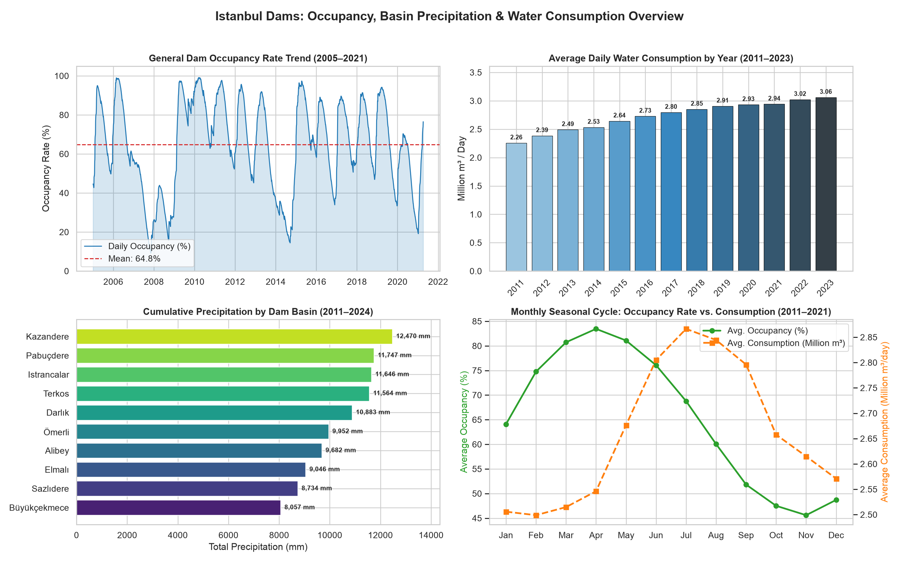
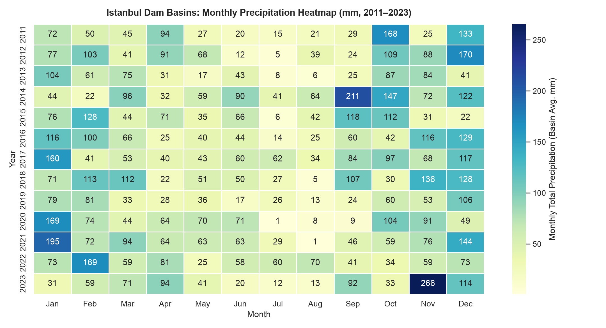
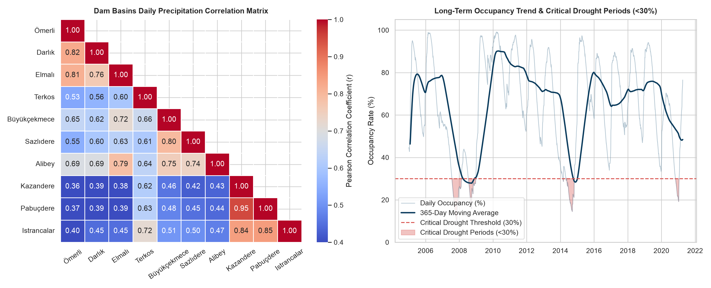

# 💧 İstanbul Barajları Doluluk, Yağış ve Günlük Su Tüketimi Analizi

> 🌐 **Dil / Language:** [🇬🇧 English](README.md) | **🇹🇷 Türkçe**

Bu proje, İstanbul'daki **10 ana baraj havzasının** (Ömerli, Darlık, Elmalı, Terkos, Büyükçekmece, Sazlıdere, Alibey, Kazandere, Pabuçdere, Istrancalar) günlük yağış verilerini, İstanbul genel baraj doluluk oranlarını, rezerv su miktarlarını ve günlük su tüketim eğilimlerini **Power BI** ve **Python** kullanarak inceleyen uçtan uca bir veri analitiği ve iş zekası (BI) çalışmasıdır.

---

## 🎯 Projenin Amacı

- **İklim ve Kuraklık Takibi:** 2005–2021 yılları arasındaki günlük baraj doluluk oranlarını ve 2011–2024 yılları arasındaki baraj havzası yağışlarını inceleyerek kritik kurak dönemleri (`<%30`) tespit etmek.
- **Tüketim Trendi Analizi:** İstanbul'un nüfus ve kullanım artışına paralel olarak günlük su tüketiminin yıllar ve mevsimler bazında nasıl değiştiğini ortaya koymak.
- **Mevsimsel Döngü ve Havza Kümelemesi:** Barajların en yüksek doluluğa ulaştığı ilkbahar ayları ile su tüketiminin zirve yaptığı yaz ayları arasındaki ters yönlü mevsimsel ilişkiyi ve 10 baraj havzasının coğrafi yağış korelasyonunu modellemek.
- **İş Zekası (BI) Raporlaması:** Power BI (`108_analiz.pbix`) üzerinde interaktif filtreleme, zaman hiyerarşisi ve baraj bazlı karşılaştırma imkânı sunan bir gösterge paneli oluşturmak.

---

## 📊 Temel Analitik Bulgular

- **Ortalama Doluluk Oranı (2005–2021):** `%64.76` (Ortalama Rezerv Su: `562.5 Milyon m³`)
- **En Yüksek / En Düşük Doluluk:** `%99.16` (`861 Milyon m³`) / `%9.20` (`80 Milyon m³` — Kasım 2007 kuraklığı)
- **Ortalama Günlük Su Tüketimi (2011–2024):** `2.737.182 m³/gün` (2011'de `2.26 Milyon m³/gün` iken 2023'te `%35.4` artışla `3.06 Milyon m³/gün`)

